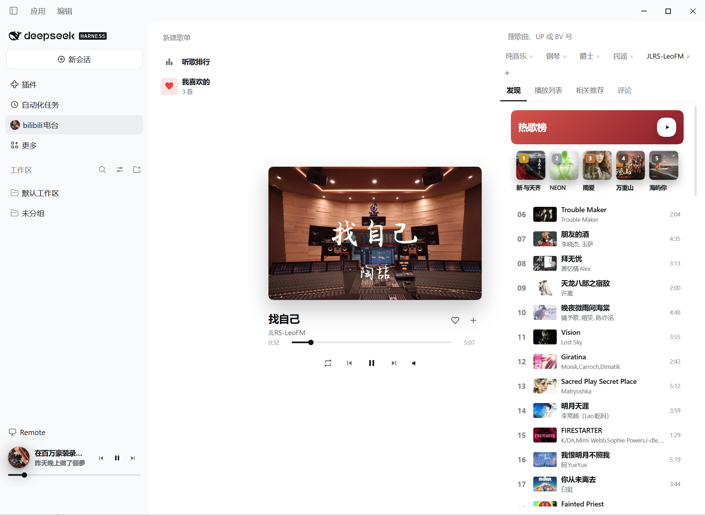
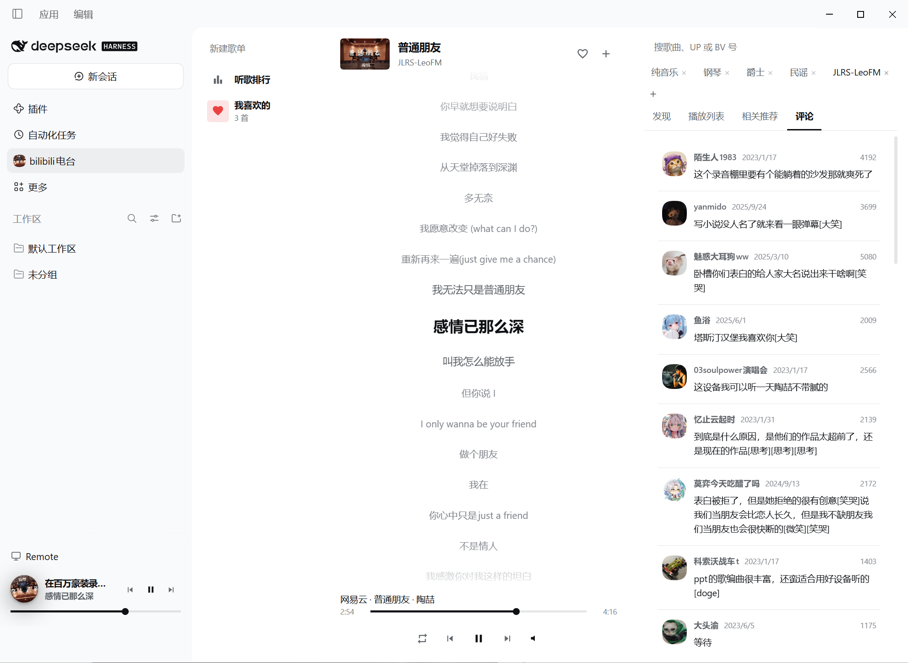
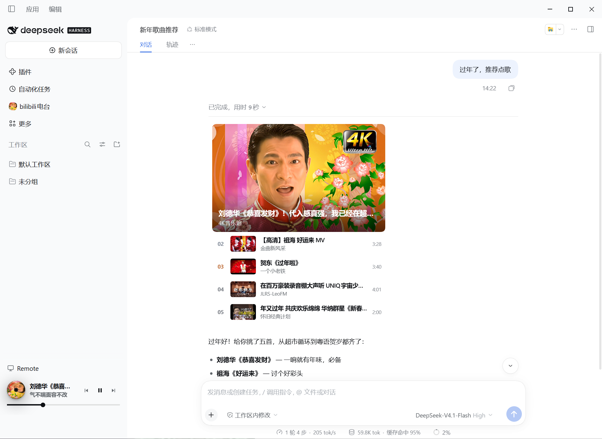
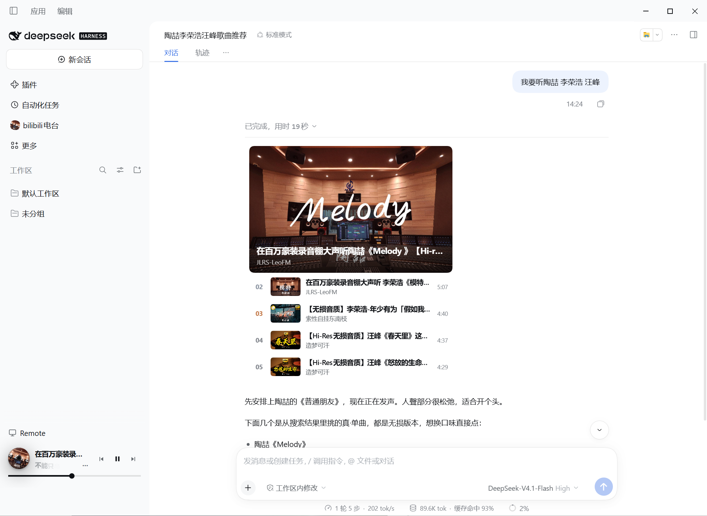

# dsh-bilibili-radio

<p align="center">
  
</p>

<p align="center"><strong>bilibili电台</strong></p>

<p align="center"><sub>让大肥鱼唱歌给你听</sub></p>

<p align="center">
  <a href="https://github.com/deepseek-ai/deepseek-harness"></a>
  <a href="https://github.com/deepseek-ai/deepseek-harness"></a>
</p>

<p align="center">
  <code>dsh plugin --profile web add github:cestbonn/dsh-bilibili-radio</code>
</p>

<p align="center">
  
</p>

---

## 安装

需要 [DeepSeek Harness](https://github.com/deepseek-ai/deepseek-harness) **0.2.2-rc.1+**（peer：`@deepseek-ai/dsh-tools`）。

```sh
dsh plugin --profile web add ./dsh-bilibili-radio
```

从 GitHub：

```sh
dsh plugin --profile web add github:cestbonn/dsh-bilibili-radio
```

装完重开 DSH。需要能访问 B 站。音源走本机 `127.0.0.1:13210` 代理。

## 功能

- **播放器**：一个简约的播放器。
- **滚动歌词**：自动搜索歌词轨。
- **歌单**：播放列表、我喜欢的、听歌排行、自定义歌单。
- **发现**：B站各音乐榜单、相关推荐、搜索歌曲/up主。
- **收藏 UP**：收藏常听的 UP。
- **大肥鱼**：想听什么，让大肥鱼操作；找歌、操作歌单、切歌等。

## 使用案例

滚动歌词：



对话里点歌：





## 反馈

欢迎开 issue、提新功能。

